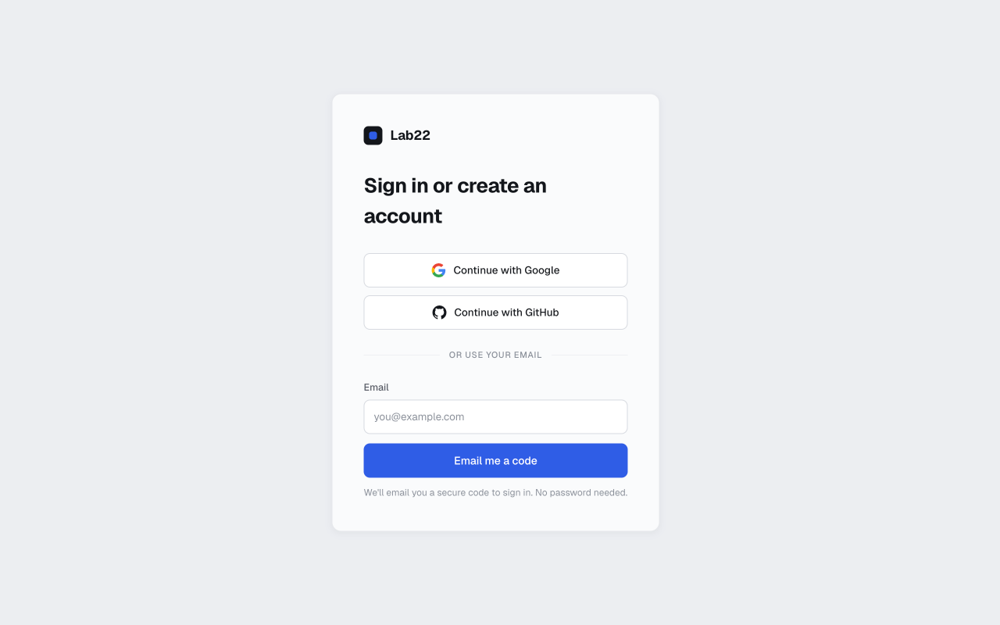
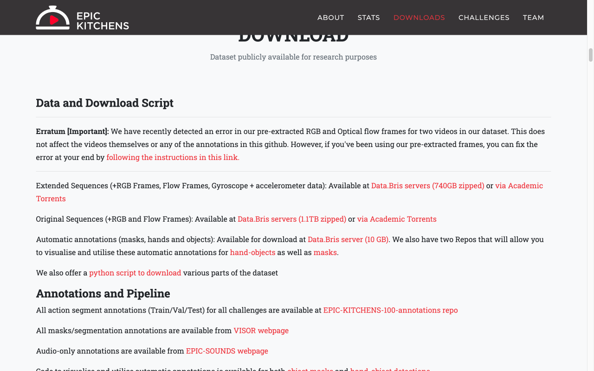
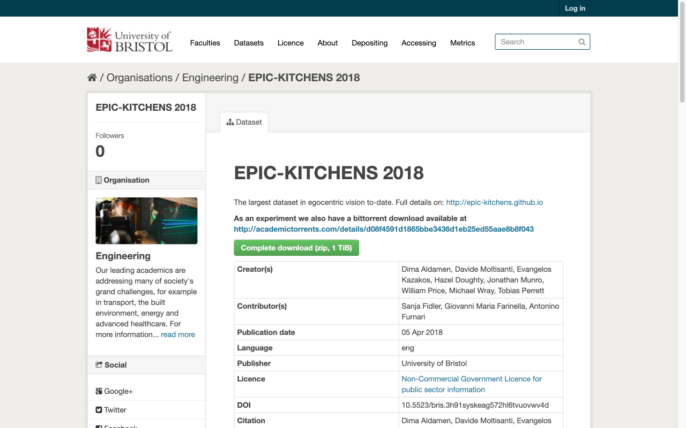
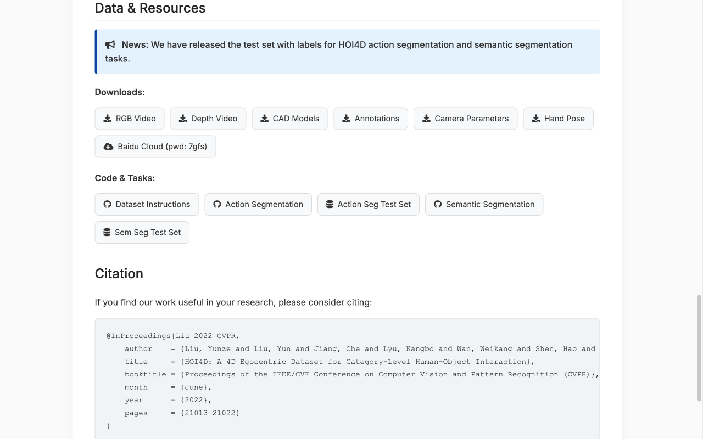
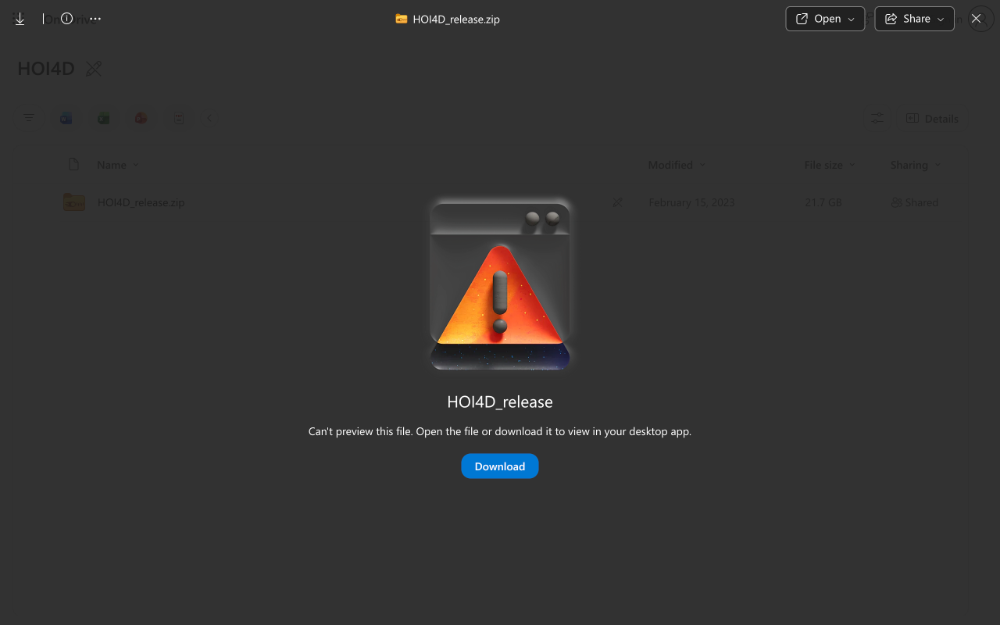

# Month 1 Egocentric Datasets Acquisition Guide

This document provides a comprehensive, verified guide for obtaining the three primary egocentric datasets specified in **Month 1** ([`TOPIC_PLAN.md`](file:///Volumes/HP_P900/Users/tungnguyen/Programming/Robot/user-work/TOPIC_PLAN.md) and [`EXECUTION.md`](file:///Volumes/HP_P900/Users/tungnguyen/Programming/Robot/user-work/EXECUTION.md)):

1. **Ego4D**
2. **EPIC-Kitchens (EPIC-KITCHENS-100)**
3. **HOI4D**

---

## 1. Ego4D

### Exact Name & Structure in Lab22
> [!IMPORTANT]
> **Key Answers & Clarifications:**
> - **Do you need an AWS account?** **NO.** Lab22 now manages direct downloads through its own infrastructure and API key system (`LAB22_API_KEY`). You do not need an AWS account or AWS IAM setup.
> - **Exact Dataset Identifier:** In the Lab22 platform and CLI, the dataset is titled exactly **`ego4d`** (current release: `v2_1`, consisting of 50,774 files and 12.1 TB total indexed files).
> - **Why you couldn't find it in a search bar:** Lab22 is not an open repository catalog like Hugging Face or Kaggle. It is the dedicated licensing hub built by the Ego4D team specifically for **`ego4d`** and **`egoexo4d`**. All licensing and datasets are accessed via the **Licenses** tab and **API keys** tab in the sidebar of your Lab22 account.

### Dataset Sizing Breakdown (from `lab22 datasets`)
| Dataset Identifier | Access | Release | Files | Total Size |
| :--- | :--- | :--- | :--- | :--- |
| **`ego4d`** | `download` | `v2_1` | 50,774 | **12.1 TB** |
| **`egoexo4d`** | `download` | `v2` | 357,153 | **35.0 TB** |

*Note on parts:*
- Full-resolution video collection (`--parts full_scale`): ~7.2 TB
- Single full-resolution video sample: ~230 MB
- Metadata / Annotations (`--metadata`): ego4d.json + benchmark labels

---

### Acquisition Steps with Lab22 CLI

#### Step 1: Request License & Generate API Key
1. Sign in to your account at [https://www.lab22.ai/signin](https://www.lab22.ai/signin).



2. In your account sidebar:
   - Go to the **Licenses** tab and request an approved license for **`ego4d`**.
   - Go to the **API keys** tab and create a new key (`l22_sk_live_...`). Copy it immediately (it is only displayed once).

#### Step 2: Install the Lab22 CLI
Create an environment (Python 3.9+) and install `lab22`:
```bash
python3 -m venv ~/lab22-venv
source ~/lab22-venv/bin/activate
pip3 install lab22
lab22 --version
```

#### Step 3: Configure Your API Key
Export your key in your terminal session:
```bash
export LAB22_API_KEY="l22_sk_live_..."
```

Check your authorized datasets:
```bash
lab22 datasets
```
*(This will confirm access to `ego4d` release `v2_1`).*

#### Step 4: Preview & Download Target Sequences

1. **Dry-Run Preview (Test a single UID without downloading full 7+ TB):**
   ```bash
   lab22 download ego4d -o ~/lab22-data/ego4d --parts full_scale --metadata \
       --uids 000cd456-ff8d-499b-b0c1-4acead128a8b --dry-run
   ```

2. **Download & Verify Selected Sequences:**
   ```bash
   lab22 download ego4d -o ~/lab22-data/ego4d --parts full_scale --metadata \
       --uids 000cd456-ff8d-499b-b0c1-4acead128a8b
   
   # Verify file integrity via checksum:
   lab22 verify ~/lab22-data/ego4d --checksum
   ```

> [!TIP]
> Running `lab22 download ego4d -o ~/lab22-data/ego4d --parts full_scale` without `--uids` will download the complete collection of 7.2 TB full-scale videos. Use `--help` on any subcommand (e.g. `lab22 download --help`) for granular filtering options.

---

## 2. EPIC-Kitchens (EPIC-KITCHENS-100)

### Current Status
- Hosted by the **University of Bristol Research Data Repository** (`data.bris.ac.uk`), GitHub, and Academic Torrents.
- Open non-commercial license (CC BY-NC 4.0). No waiting period for credential approval.

### Dataset Sizing Breakdown
| Component | Download / Storage Size | Description |
| :--- | :--- | :--- |
| **Extended Sequences (100h)** | **740 GB** (zipped) | RGB frames, Optical Flow, and IMU data |
| **Original Sequences (55h)** | **1.1 TB** (zipped) | Original 2018 video streams and frames |
| **Total Uncompressed Storage** | **~2.5 – 3.0 TB** | Full extracted RGB frame sequences |
| **Automatic Object & Hand Masks** | **10 GB** | Pixel-wise segmentations and detections |
| **Action Annotations (GitHub)** | **~50 MB** | Train/val/test action segments & narrations |

### Acquisition Steps

#### Step 1: Choose Distribution Option
Access the official download portal:
- **EPIC-KITCHENS 2026 Portal:** [https://epic-kitchens.github.io/2026#downloads](https://epic-kitchens.github.io/2026#downloads)
- **Data.Bris Server:** [https://data.bris.ac.uk/data/dataset/3h91syskeag572hl6tvuovwv4d](https://data.bris.ac.uk/data/dataset/3h91syskeag572hl6tvuovwv4d)





#### Step 2: Download Selective Clips / Participants
Clone the official download script repository:
```bash
git clone https://github.com/epic-kitchens/epic-kitchens-download-scripts.git
cd epic-kitchens-download-scripts
pip install -r requirements.txt
```

Download annotations repository (instant, ~50 MB):
```bash
git clone https://github.com/epic-kitchens/epic-kitchens-100-annotations.git
```

Download specific participant or specific video with verified flags:
```bash
# Download only RGB frames for participant P01 on the training split:
python epic_downloader.py --rgb-frames --train --participants P01 --output-path ~/datasets/epic

# Download only one specific video sequence (e.g. P01_01, ~1.5 GB):
python epic_downloader.py --rgb-frames --train --specific-videos P01_01 --output-path ~/datasets/epic

# Download Mask R-CNN hand-object masks for participant P01:
python epic_downloader.py --masks --participants P01 --output-path ~/datasets/epic
```

---

## 3. HOI4D

### Current Status
- **Old URL Deprecated:** The previous website (`http://hoi4d.top/`) and repo (`HOI4D/HOI4D_instructions`) are inactive (returning 404).
- **Official Website:** [https://hoi4d.github.io/](https://hoi4d.github.io/)
- **Active Toolkit Repository:** [https://github.com/leolyliu/HOI4D-Instructions](https://github.com/leolyliu/HOI4D-Instructions)
- **Direct Cloud Access:** Download links are hosted directly on **OneDrive** and **Baidu Cloud** (`pwd: 7gfs`). **No approval form or waiting period is required anymore.**

### Dataset Sizing Breakdown
| Component | Download / Storage Size | Description |
| :--- | :--- | :--- |
| **`HOI4D_release.zip` (Core RGB)** | **21.7 GB** | Primary video sequences and metadata |
| **Full Dataset Archive (RGB + Depth + Point Clouds)** | **~1.83 TB** | Complete raw release (also on HuggingFace `Livioni/hoi4d`) |
| **Uncompressed Extracted Frames** | **~2.5 – 3.0+ TB** | Extracted 2.4M RGB-D frames from 4,000+ sequences |
| **CAD Models (`CAD_models.zip`)** | **~350 MB** | Category 3D meshes for objects |
| **Annotations (`Annotations.zip`)** | **~1.2 GB** | Category 6D object poses & MANO hand poses |
| **Camera Parameters** | **~15 MB** | Camera intrinsics and extrinsics matrices |

### Acquisition Steps

#### Step 1: Direct Download from Links
1. Open [https://hoi4d.github.io/](https://hoi4d.github.io/).
2. Under **Data & Resources / Downloads**, click the component you need:
   - **CAD Models** (`CAD_models.zip`, ~350 MB)
   - **Annotations** (`Annotations.zip`, ~1.2 GB)
   - **Camera Parameters** (~15 MB)
   - **RGB Video** (`HOI4D_release.zip`, 21.7 GB)



3. Clicking **RGB Video** opens the OneDrive link directly to `HOI4D_release.zip` (21.7 GB). Click **Download**:



#### Step 2: Setup Toolkit & Decode Videos
Clone the instruction repository:
```bash
git clone https://github.com/leolyliu/HOI4D-Instructions.git
cd HOI4D-Instructions
pip install -r requirements.txt
```

To decode a specific sequence into frames without processing the entire 2.4M-frame dataset, run `ffmpeg` directly:
```bash
# Decode RGB video to JPEG frames at 15 fps:
ffmpeg -i path/to/image.mp4 -f image2 -start_number 0 -vf fps=fps=15 -qscale:v 2 output_dir/%05d.jpg

# Decode Depth video to PNG frames at 15 fps:
ffmpeg -i path/to/depth_video.avi -f image2 -start_number 0 -vf fps=fps=15 -qscale:v 2 output_dir/%05d.png
```

Or edit `release.txt` in the repository to only include the target sequence IDs and run:
```bash
python utils/decode.py
```

---

## 4. Summary: Quick-Reference for Small Test Downloads

| Dataset | Target Small Subset | Command / Method | Size |
| :--- | :--- | :--- | :--- |
| **Ego4D** | 1 Sample Video UID + Metadata | `lab22 download ego4d -o ~/lab22-data/ego4d --parts full_scale --metadata --uids 000cd456-ff8d-499b-b0c1-4acead128a8b` | **~230 MB** |
| **Ego4D** | FHO Benchmark Clips + Annotations | `lab22 download ego4d -o ~/lab22-data/ego4d --parts clips annotations --benchmarks FHO -y` | **~1.2 GB** |
| **EPIC-100** | Annotations only | `git clone https://github.com/epic-kitchens/epic-kitchens-100-annotations.git` | **~50 MB** |
| **EPIC-100** | Single Video (`P01_01`) RGB frames | `python epic_downloader.py --rgb-frames --train --specific-videos P01_01` | **~1.5 GB** |
| **HOI4D** | CAD Models & Annotations | Download `CAD_models.zip` & `Annotations.zip` from [hoi4d.github.io](https://hoi4d.github.io/) | **~1.5 GB** |

---

## 5. Downloading ~100 GB per Dataset (Practical Working Sets)

Downloading ~100 GB per dataset provides a rich, diverse training/validation distribution without filling multiple terabytes of local disk.

### 1. Ego4D: ~100 GB Selection

The `lab22` CLI offers two precise ways to target ~100 GB:

#### Strategy A: Sharding the Full-Scale Collection (~103 GB)
Since the total full-scale video set is **7.2 TB**, using the built-in `--shard` option splits the dataset into equal deterministic chunks. Sharding `1/70` yields roughly **~103 GB** across varied scenarios:
```bash
# 1. Preview the exact size and file list:
lab22 download ego4d -o ~/lab22-data/ego4d --parts full_scale --metadata \
    --shard 1/70 --dry-run

# 2. Download the ~100 GB shard:
lab22 download ego4d -o ~/lab22-data/ego4d --parts full_scale --metadata \
    --shard 1/70 -y
```

#### Strategy B: FHO Interaction Clips (~80 – 100 GB)
Target all Forecasting Hands and Objects interaction clips across the dataset:
```bash
lab22 download ego4d -o ~/lab22-data/ego4d --parts clips --benchmarks FHO --metadata --dry-run
lab22 download ego4d -o ~/lab22-data/ego4d --parts clips --benchmarks FHO --metadata -y
```

---

### 2. EPIC-Kitchens: ~100 GB Selection

In EPIC-KITCHENS-100, there are 45 kitchens (`P01` to `P45`). On average, each participant represents **~18 to 22 GB** of raw video footage.

To download **~90 – 100 GB**, target the first 5 participants (`P01` through `P05`):

```bash
# Clone the downloader if you haven't already:
git clone https://github.com/epic-kitchens/epic-kitchens-download-scripts.git
cd epic-kitchens-download-scripts
pip install -r requirements.txt

# Download ~90-100 GB of MP4 videos for 5 participants on the train split:
python epic_downloader.py --videos --train \
    --participants P01,P02,P03,P04,P05 \
    --output-path ~/datasets/epic_kitchens
```

*(If you prefer pre-extracted RGB frame bundles rather than raw `.MP4` videos, select `P01,P02,P03` with `--rgb-frames`, which equals ~85–100 GB).*

---

### 3. HOI4D: ~100 GB Selection

In HOI4D, the data distribution is naturally split between compressed archives and decoded frame sequences:

1. **Download the Core Archives (~23.3 GB download):**
   - Download `HOI4D_release.zip` (**21.7 GB**) from the OneDrive link on [hoi4d.github.io](https://hoi4d.github.io/).
   - Download `Annotations.zip` (**1.2 GB**).
   - Download `CAD_models.zip` (**0.35 GB**).
   - Download `Camera Parameters` (**~15 MB**).

2. **Unpack & Selective Category Decoding (~80 – 100 GB working set):**
   - Unzipping `HOI4D_release.zip` yields **~65–75 GB** of synchronized `image.mp4` and `depth_video.avi` video files across hundreds of interaction sequences.
   - For dexterous manipulation (Month 1), decode frames only for the primary manipulation object classes (`C2` Mug, `C5` Bottle, `C7` Bowl, `C9` Scissors, `C12` Kettle, `C13` Knife):
     ```bash
     # Filter release.txt to include only manipulation categories (C2, C5, C7, C9, C12, C13):
     grep -E "/(C2|C5|C7|C9|C12|C13)/" release.txt > release_manipulation.txt

     # Decode these selected sequences to reach an active ~100 GB working dataset:
     python utils/decode.py  # (using release_manipulation.txt)
     ```


